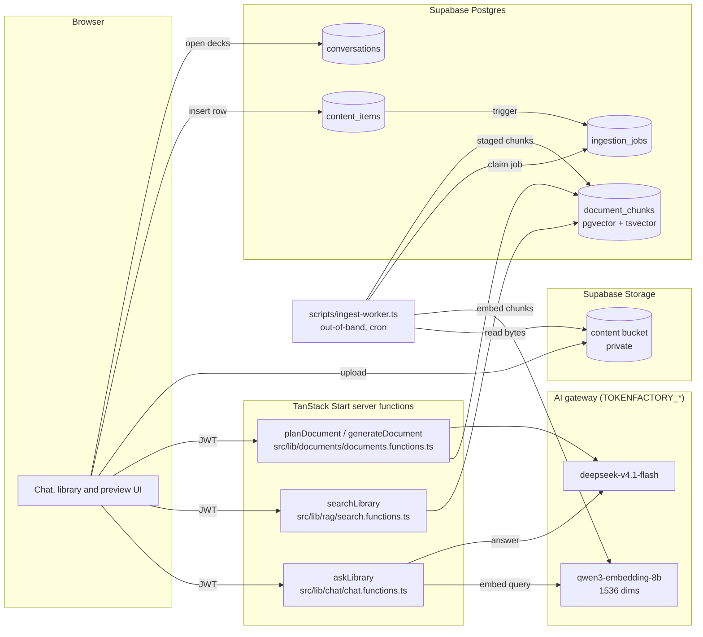
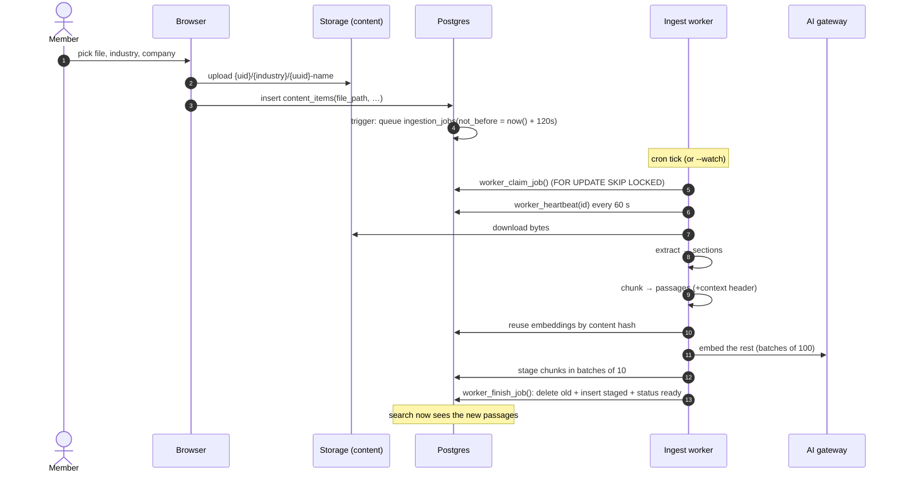
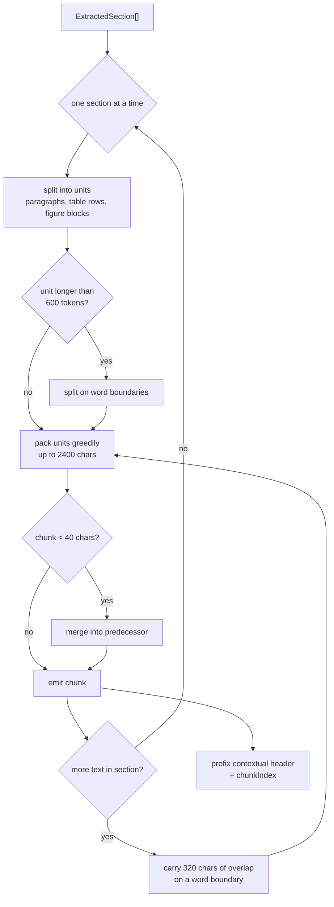
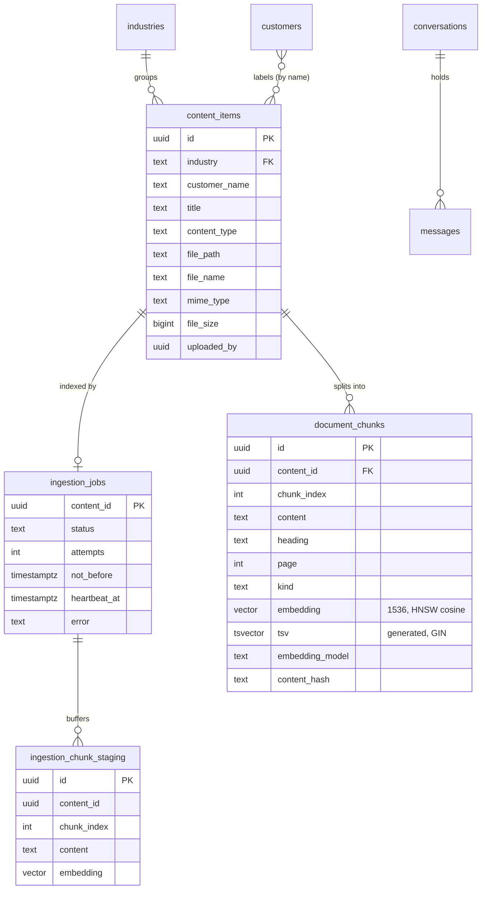
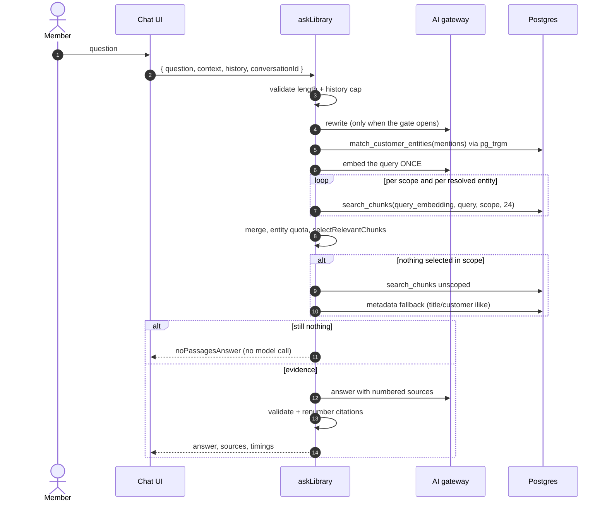
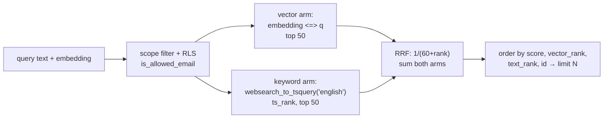
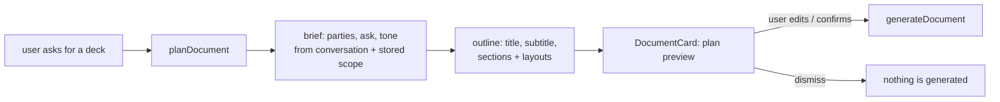
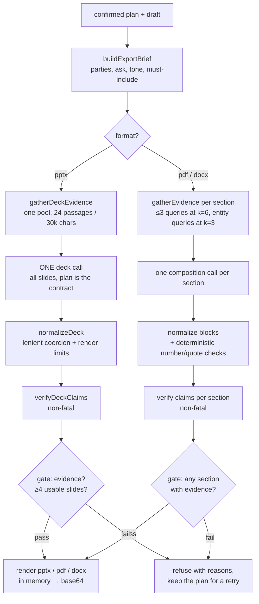
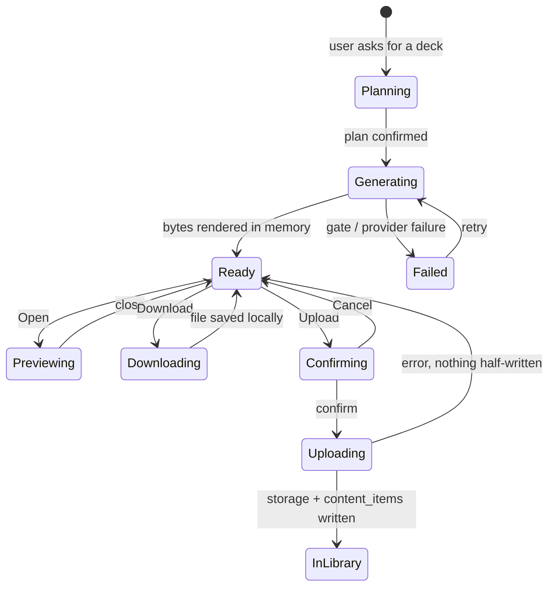
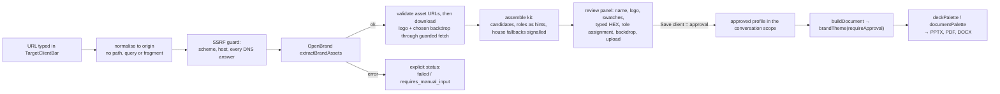

# The RAG pipeline, end to end

This is the only handoff document for this codebase. It explains how a file gets
from an upload to a citation, how a question becomes a grounded answer, and how a
generated deck is created, delivered and (optionally) saved back into the
library. If you read one thing before changing retrieval, ingestion, prompting or
document generation, read this.

It is written to be read once, front to back, in about thirty minutes. Every
number quoted here is a real constant in the repository — the file that owns it
is named next to it, so you can check rather than trust.

---

## 1. The system in one picture



Two loops, one index:

- **The write loop** turns bytes into passages. It is the only place that talks to
  the storage bucket and the only place that writes `document_chunks`. It runs
  out of band, because parsing a 40-slide deck or a 100-page PDF does not fit in
  a request.
- **The read loop** turns a question into evidence and an answer, and it is
  strictly read-only. It never writes chunks, never needs a service key, and
  never learns whether a passage came from an upload or a generated deck.

The index they share is plain Postgres: one row per passage in
`document_chunks`, with an `embedding vector(1536)` and a generated
`tsvector`. There is no external vector database, no separate search cluster and
no second copy of the corpus.

---

## 2. Invariants

These hold everywhere. Break one and the failure is quiet, which is why they are
listed before the mechanics.

1. **RLS is the only authorisation boundary.** Every read in the pipeline runs
   as the signed-in member, `search_chunks` is `security invoker`, and the
   server functions run behind auth middleware. Client-side role checks only
   change what is rendered.
2. **`content_items` is the source of truth for metadata.** Chunk rows store
   text and vectors, not titles, industries or customer names. Renaming a company
   or moving a file is correct on the next query with no re-index. (Exceptions:
   the contextual header baked into chunk text, and provenance columns written by
   the worker; both are derived from the file, not from mutable labels.)
3. **One writer.** Only the ingestion worker writes `document_chunks`, and only
   through worker RPCs that re-check `is_ingestion_worker()`. Server functions
   and the browser never insert passages.
4. **Nothing in the corpus is unindexed by accident.** A file with no chunks is a
   job with a status, and the status is visible in `ingestion_jobs`.
5. **No answer without evidence.** If retrieval selects nothing, the model is not
   called at all; the UI receives a refusal that names what was searched.
6. **The model never owns citation numbers.** The server issues the source
   numbers, validates the markers the model emits, and renumbers them by first
   use.
7. **Generation is explicit.** A document is only produced after the user
   confirms a plan, and a generated file only reaches the library after the user
   confirms an upload. Neither step is inferred from tone or from a previous turn.

---

## 3. Where the code lives

| Path                                    | Owns                                                                                                               |
| --------------------------------------- | ------------------------------------------------------------------------------------------------------------------ |
| `src/lib/rag/config.ts`                 | Every tunable: model names, versions, budgets, thresholds. No magic numbers elsewhere.                             |
| `src/lib/rag/search.ts`                 | Query embedding, hybrid RPC call, entity scoping, relevance selection, metadata fallback, `gatherLibraryEvidence`. |
| `src/lib/rag/entities.ts`               | Mention splitting and `match_customer_entities` (pg_trgm) resolution.                                              |
| `src/lib/rag/embeddings.ts`             | Provider call, batching, dimension check, cost accounting.                                                         |
| `src/lib/rag/extract.ts`                | PDF / DOCX / PPTX parsing into `ExtractedSection[]`. Pure and dependency-light per format.                         |
| `src/lib/rag/chunk.ts`                  | Section-preserving chunker, token estimate, table handling, contextual header.                                     |
| `src/lib/rag/ingest.ts`                 | One document: hash, reuse-or-embed, staging batches, atomic commit, failure recording.                             |
| `src/lib/rag/eval.ts`, `answer-eval.ts` | Retrieval metrics and answer scoring behind `bun run eval` / `eval:answers`.                                       |
| `src/lib/rag/vision.ts`                 | Optional image descriptions for picture-only slides.                                                               |
| `src/lib/chat/chat.functions.ts`        | `askLibrary`: rewrite → entities → scopes → evidence → answer → citations.                                         |
| `src/lib/chat/rewrite.ts`               | The follow-up rewrite gate and its small completion.                                                               |
| `src/lib/chat/answer.ts`                | Prompt, context block, model call, continuations, citation post-processing.                                        |
| `src/lib/chat/scope.ts`                 | Turns context (`clients`, `industries`, …) into SQL filters and search hints.                                      |
| `src/lib/chat/conversationScope.ts`     | Persisted per-conversation scope (`conversations.scope`, migration 0022).                                          |
| `src/lib/documents/retrieval.ts`        | Evidence for a document: per-section (`gatherEvidence`) and whole-deck (`gatherDeckEvidence`) pools.               |
| `src/lib/documents/build.ts`            | Orchestrator: brief → plan → evidence → compose → verify → gate → render.                                          |
| `src/lib/documents/deck.ts`             | The single deck composition call and its prompt.                                                                   |
| `src/lib/documents/slides.ts`           | Lenient normaliser: coerce model JSON into render-safe slides.                                                     |
| `src/lib/documents/verify.ts`           | Post-generation claim check; removes unsupported blocks, never fails the document.                                 |
| `src/lib/documents/render/*`            | `pdf.ts`, `docx.ts`, `pptx.ts` — bytes built in memory.                                                            |
| `src/components/chat/DocumentCard.tsx`  | The document confirmation card: Download, Open, Upload-with-confirm.                                               |     | `scripts/ingest-worker.ts` | The out-of-band entry point (`--backfill`, `--once`, `--id`, `--watch`) and the job RPC calls (claim, heartbeat, fail, finish). |

The read path is deliberately three files deep at most: a server function calls
`gatherLibraryEvidence` (or `searchLibraryChunks`), which calls `search_chunks`
in SQL. There is no retrieval service layer, no `retrieve()` wrapper and no
policy object; the fallback order is written once, in one function, where you can
see all of it.

---

## 4. The write loop: bytes become passages



### 4.1 Enqueue: the 120-second delay

An insert **or** an update of `file_path`/`file_size` on `content_items` queues a
job (`drizzle/migrations/0013_ingestion_enqueue.sql`, delay in `0015`). The job
starts `not_before = now() + 120 s`.

Why not ingest immediately? Uploads arrive in bursts, and a mis-picked file is
usually deleted or replaced within seconds. Waiting two minutes means the final
bytes are parsed once instead of twice, and a delete can cancel the work before
it costs anything. Requeues bypass the delay (`not_before = now()`), because a
deliberate re-index is not a burst.

A job row carries `content_id` (unique — one live job per file), `status`
(`queued` → `running` → `ready` | `empty` | `failed` | `skipped`), `attempts`,
`error`, `extractor_version`, a lease timestamp and a heartbeat.

### 4.2 Claiming and liveness

`worker_claim_job()` takes one job with `FOR UPDATE SKIP LOCKED`, so several
workers never fight over the same row. `worker_heartbeat()` is called every 60 s
and a job whose heartbeat is older than **5 minutes** is reclaimable — a 40-slide
deck is slow but healthy, and only a genuinely dead worker loses its lease. After
**3 attempts** a job lands in `failed` with a truncated error string.

The worker authenticates as the allowlisted member account
(`ingestion_worker_users`, `LIBRARY_USER_EMAIL`/`PASSWORD`), not a service role.
Every worker RPC is `security definer` plus `is_ingestion_worker()`, so a
compromised browser session cannot stage chunks.

### 4.3 Storage layout

One private bucket: `content` (1 GiB per object, `public = false`). Policies from
`0001`/`0005`/`0009` require an allowed email, and writes must place the object
under the uploader's own uid:

```
content/{auth.uid()}/{industrySlug}/{uuid}-{safe-file-name}
```

Reads are scoped to the object owner or an admin, mirroring `content_items` RLS.
The bucket is private because a case study can name a client; previews therefore
download through authenticated Storage into a **revocable blob URL**, never a
signed public link and never a hosted third-party viewer.

### 4.4 Extraction, per format

`extract.ts` returns `ExtractedSection[]` — ordered sections with a `kind`, a
heading and a metadata bag. It is the only file in the pipeline that is allowed a
`try/catch` around third-party parsers, because malformed files are a normal
input.

| Format | Library        | What is extracted                                                                                                                                                                                                                           |
| ------ | -------------- | ------------------------------------------------------------------------------------------------------------------------------------------------------------------------------------------------------------------------------------------- |
| PDF    | `unpdf`        | Per-page text, page number in metadata. Scanned pages yield nothing — there is no OCR.                                                                                                                                                      |
| DOCX   | `mammoth`      | Paragraphs and headings with a style map, so heading levels survive and can be used as section boundaries. Tables become rows of text.                                                                                                      |
| PPTX   | `fflate` (own) | Zipped XML read directly: slide order from the presentation, shapes in document order, `a:tbl` tables as rows, chart series from cached values, SmartArt from its data part, speaker notes appended, picture-only slides offered to vision. |

Presentation order comes from the relationship order in `presentation.xml`, not
from file names, so slide numbers match what a person sees in PowerPoint.
Chart numbers come from the _cached_ values inside the chart part, which is why a
chart question can be answered without rendering anything.

Picture-only slides are the one gap. With `RAG_VISION=1` up to **8** images per
document (≥ 24 KB, or slides with < 400 characters of text) are described by a
vision model and the description becomes the slide's text. With vision off they
land as title-only sections, which retrieval will use as a label but never as
evidence. Scanned PDFs land as `empty` with a warning rather than as a silent
success.

### 4.5 Chunking

`chunk.ts` is a **structure-preserving, token-budgeted window with overlap** — not
semantic chunking, and not fixed-size slicing.



The knobs:

| Knob                 | Value              | Where                    |
| -------------------- | ------------------ | ------------------------ |
| target size          | 600 tokens         | `chunkSections` defaults |
| overlap              | 80 tokens          | same                     |
| hard minimum         | 40 chars           | `MIN_CHUNK_CHARS`        |
| token estimate       | 4 characters/token | `estimateTokens`         |
| oversized unit split | word boundaries    | inside `chunkSections`   |

Consequences worth knowing:

- **Sections are never merged.** A slide, a page or a DOCX heading starts a new
  chunk sequence. That is what makes `slide 7` a trustworthy citation.
- **Tables stay row-aware.** Rows are packed together and the header row is
  repeated in the overlap, so a passage can be read without its neighbours.
- **A stub is merged backwards**, never embedded alone. A 12-character orphan
  chunk is noise in both the vector arm and the keyword arm.
- **Overlap is taken from the previous chunk's tail on a word boundary**, with an
  abbreviation shield so `Ltd.` is not treated as a sentence end.
- **`chunkIndex` runs across the whole document**, so "the passage after this one"
  is a cheap query and neighbour expansion in document generation is exact.

### 4.6 The contextual header

Before embedding, each passage gets one line of context prepended to its text:

```
Customer: InterGlobe Hotels | Industry: hospitality | Document: IndiGo × Bluedart — ops review | Slide: 7 | Section: Cost per shipment
```

This matters because a passage is retrieved alone. `$4.2M` means nothing without
"cost per shipment, IndiGo, 2025". The header is placed **inside `content`**, not
in a separate column, because `content` is the one field both the FTS index and
the embedding see. It is not placed in `heading`, because citations must show the
real section title.

`scripts/backfill-chunk-context.ts` re-embeds existing chunks with the header
(≤ 200 rows per `worker_update_chunk_context` call).

### 4.7 Embeddings and idempotency

`embeddings.ts` calls `qwen/qwen3-embedding-8b` at **1536 dimensions**, in
batches of **100** (the provider's limit), restoring order by index and rejecting
any response whose dimension is not 1536 — a silent dimension change would
degrade every ranking without an error.

Before embedding, `ingest.ts` computes a content hash over the extracted text
plus `EXTRACTOR_VERSION` and `CHUNKER_VERSION`. Unchanged chunks keep their
existing vectors; only new text is sent to the provider. Bumping either version
therefore makes every file look new, which is exactly what
`worker_requeue_all('<version>')` uses to force a complete, consistent re-index.

Cost is taken from the provider's reported usage when present, otherwise from
`EMBEDDING_USD_PER_TOKEN` (1e-7), so ingestion cost is auditable per job.

### 4.8 The atomic commit

Chunks are written in **staging batches of 10** to
`ingestion_chunk_staging`, then `worker_finish_job()` deletes the file's old
chunks, inserts the staged rows and flips the job to `ready` in one transaction.
Two reasons:

- The Data API has request-size limits; a 300-chunk deck cannot be one call.
- A retry must never produce duplicate passages or a half-indexed document. Until
  the commit lands, search keeps seeing the previous version of the file —
  re-indexing is invisible to readers.

The worker RPCs set their own `statement_timeout` (60 s) because writing vectors
is slower than a normal query.

### 4.9 When ingestion goes wrong

| Status    | Meaning                                                     | What to do                                  |
| --------- | ----------------------------------------------------------- | ------------------------------------------- |
| `queued`  | waiting for `not_before` or a free worker                   | check the cron tick                         |
| `running` | leased; heartbeat within 5 min                              | wait, or inspect `attempts`                 |
| `empty`   | extractor found no text (scan, image-only deck, empty file) | OCR is out of scope; vision helps PPTX only |
| `skipped` | unsupported format                                          | add the format (see §17)                    |
| `failed`  | 3 attempts exhausted; `error` holds the last message        | fix, then `worker_requeue_all`              |

`worker_requeue_all(version)` re-queues files whose `extractor_version` differs
or is null, failed jobs, and `ready` jobs with zero chunks; it also inserts a job
for any item that has none. It skips `running` jobs and does not delete current
chunks until the new run commits.

---

## 5. Storage: why Postgres, and what the schema is



Read the SQL, it is short: `0010` (tables, indexes, RLS), `0011` (grants), `0012`
(reconcile), `0013`/`0015` (enqueue), `0014` (hybrid search), `0017` (worker RPCs),
`0019` (provenance), `0020` (entity matching), `0021` (context backfill), `0022`
(conversation scope).

Indexes: **HNSW with `vector_cosine_ops`** on `embedding`, **GIN** on `tsv`, plus
`(content_id, chunk_index)` and a unique `(content_id, chunk_index)` for staging
integrity.

**Why not a dedicated vector database?** Because the index must obey the same
security rules as the files. Here, `document_chunks` inherits RLS through
`content_items`, and deleting a content item cascades to its passages in the same
transaction. An external store would need a synchronisation path, a second copy of
customer names, and a story for the window in which a deleted file is still
retrievable. At this corpus size (tens of thousands of passages) pgvector's brute
force and HNSW are both comfortable, and `EXPLAIN` is one command away.

**Why join metadata at read time instead of copying it onto chunks?** A rename or
a company merge (`rename_company` RPC) becomes instantly correct, and there is no
backfill to forget. The cost is a join on a primary key, which is cheaper than the
class of bugs it prevents.

**Why keep the raw file in Storage at all, if the text is in Postgres?** Citations
must open the original, and a preview must show the real layout — a chunk cannot
reproduce a chart. Storage holds the only copy of the bytes; Postgres holds the
searchable projection.

---

## 6. The read loop: a question becomes evidence



Entry points, all behind Supabase auth middleware:

- `askLibrary` — the chat turn described above (`chat.functions.ts`).
- `searchLibrary` — same hybrid search without an answer, used by the library
  search box; it returns ranked chunks and scores.
- `gatherEvidence` / `gatherDeckEvidence` — the document-generation pools (§9).

### 6.1 Turn order in `askLibrary`

1. Validate: question 2–2000 chars, optional context, ≤ 10 history messages.
2. Fail fast with "AI Search is not configured yet" when provider env is missing.
3. Rewrite the message if the gate opens (§6.2); log raw and rewritten.
4. Resolve every named organisation (§6.3).
5. Merge resolved clients (at 0.86) with named entities by normalised key.
6. Build retrieval scopes from the conversation scope (§6.4).
7. `gatherLibraryEvidence` embeds the query once, searches 24 candidates per scope
   and per entity, applies `selectRelevantChunks`, then falls back to the
   unscoped library (when scoped) and finally to metadata (§6.6–6.8).
8. Log `{ requestId, source, candidates, selected, documents }`. If empty →
   `noPassagesAnswer` naming the resolved entities, `grounded: false`, **no model
   call**.
9. Build the context block, call the model, post-process citations, warn on meta
   narration and dropped markers (never block), return.

### 6.2 Query rewriting

A standalone question costs no extra call. `rewrite.ts` runs a rewrite only when
the message:

- starts dependently (`and`, `also`, `what about`, `same`, `ok so`), or
- starts/ends with an ellipsis, or
- contains a pronoun (`it`, `they`, `this`, `those`, …), or
- is ≤ 5 words.

The prompt sees the last **4** turns and must return one line. The call is
`completeWithBudget` with **thinking off**, 20 s timeout, 1000 max tokens.
Thinking matters here: with reasoning on, the whole budget went to reasoning and
the rewrite came back empty with `finish_reason: length`.

`sanitizeRewrite` keeps one line, strips quotes and a `Query:` prefix, rejects
anything under 2 chars and caps at 300. Every failure path returns the raw
message with `reason: "fallback"` — the rewrite can improve a follow-up, never
block one.

### 6.3 Entity resolution

Sales questions name an organisation, often with a typo. `entities.ts`:

1. `entityCandidates` pulls candidate names from `customers` and from
   `content_items.customer_name`.
2. `match_customer_entities` (migration `0020`, `pg_trgm`) scores mentions against
   canonical names and aliases.
3. `ENTITY_SIMILARITY_THRESHOLD = 0.4` is a soft boost; at or above
   `ENTITY_FILTER_THRESHOLD = 0.86` the name becomes a **scope**.
4. At most `ENTITY_MAX_ENTITIES = 4` entities and `ENTITY_MAX_CANDIDATES = 40`
   candidates per question — beyond that a question is a survey, not a lookup.

Aliases live in `customer_aliases`; adding one takes effect on the next question
with no re-ingest. Typos are repaired for _names_, not for products or metric
labels, which is a deliberate limit.

### 6.4 Scope: what the conversation is allowed to see

Scope is explicit and persisted, not inferred on every turn:

```ts
{ industries: string[]; clients: string[] }
```

`conversations.scope` (migration `0022`) stores it, owner-only under RLS, and the
chat URL carries the conversation id, so a reload restores the same filter. The
sidebar/context bar writes it; the server never guesses it from prose.

`scopeRetrievalScopes()` turns scope into search inputs:

- one industry and/or one client → a SQL filter;
- several → hints appended to the query plus one scoped search per pair, capped
  at **8**;
- **companies chosen without an industry** → industry-wide search plus the
  client filter, so a file filed against the industry is still found.

When a turn is scoped and finds nothing, `gatherLibraryEvidence` retries
**unscoped** and reports `source: "unscoped"`. The UI says the answer came from
outside the current filter, rather than pretending the filter returned it. That
is a better failure than "no results in this industry" when the answer exists one
folder over.

`intake.ts` is the guided sequence (work type → sectors → companies per sector →
ready). It is pure, so the same logic runs in tests and in the UI, and its picks
become `context.industries` / `context.clients`.

### 6.5 Hybrid search in one SQL function



`public.search_chunks` (`0014`) is `security invoker`, so RLS on
`document_chunks` and `content_items` applies to the caller's JWT. It merges a
pgvector top-50 with a full-text top-50 using **reciprocal rank fusion, k = 60**,
and returns the fused score plus both arm ranks.

Why hybrid, and why RRF:

- The corpus is full of exact identifiers — customer names, `SLA`, `4.2M`,
  `Bluedart`. Dense retrieval embeds those into a neighbourhood and loses the
  exact match; `ts_rank` finds it.
- RRF needs no score calibration. Cosine similarity and `ts_rank` are not on the
  same scale, and a weighted sum would need per-corpus tuning that drifts with
  every upload. Rank fusion is scale-free and one constant.
- Ties are broken deterministically (score, vector rank, text rank, id) so the
  same query returns the same order in tests and in production.

`clampMatchCount` keeps the requested count in 1–50; `DEFAULT_MATCH_COUNT = 8`.

### 6.6 One query embedding, many searches

`gatherLibraryEvidence` embeds the question **once** and reuses the vector for
every scope and every entity — N searches cost one embedding call. Entity
searches append a hint line to the _text_ (`… \nCustomer: InterGlobe Hotels`) so
the keyword arm anchors on the name, while the vector stays the same.

When a question names several entities, results are merged with a per-entity
quota of `max(ENTITY_MIN_CHUNKS, ceil(k / entities))` applied **before** global
ranking. Without it, the first company's ten near-duplicate slides fill the
candidate set and the second company never appears — which is exactly the failure
mode of "compare A and B".

Deduplication is by chunk id, keeping the best score, and the merged list is
ordered by score with a stable tie-break.

### 6.7 Selection: `selectRelevantChunks`

The SQL arm always returns its top N, so the fused score alone cannot say "this
question has no answer here". Selection is a small, explicit set of rules over the
candidate pool:

1. **Entity filter** — when the turn resolved a company and is not comparative,
   keep only passages from that company (or industry-wide passages). A resolved
   name is a strong signal; a wrong resolution would otherwise pull a different
   client's deck. Comparative questions ("compare A and B") bypass the filter on
   purpose.
2. **Score floor** — keep passages scoring at least `0.5 × best`. A relative
   floor, not an absolute one, because RRF scores depend on how many arms matched.
3. **Title-only demotion** — a passage of ≤ 25 meaningful tokens whose body is
   just its title/heading (a divider slide, a cover) is moved to the end and kept
   only if its document already earned a slot. It is a label, never evidence.
4. **Diversity caps** — at most `MAX_CHUNKS_PER_DOCUMENT = 3` and
   `MAX_CHUNKS_PER_SLIDE = 2`. One deck cannot fill the prompt.
5. **No padding** — the result is between 3 and 8 passages; if only two clear the
   floor, two are returned. There is no "top 8" promise.

### 6.8 Metadata fallback: proving a file exists

If hybrid search returns nothing (or nothing survives selection) the pipeline
falls back to matching the question's names against `content_items.title`,
`customer_name` and `file_name` (control characters stripped, ≤ 2 rows per
document, ≤ 8 rows).

Those passages carry a synthetic score of **0.001** — below any fused score,
because matching a title proves a document exists, not that its text answers the
question. The UI marks them as title-only. This is the safety net that stops a
named organisation that is present in the library from being reported as absent.

`gatherLibraryEvidence` reports which path won: `scoped`, `unscoped` or
`metadata`.

---

## 7. Answering

### 7.1 Context block

Sources are numbered **in retrieval order**, one map per request:

```
[1] IndiGo × Bluedart — ops review · customer: InterGlobe Hotels · industry: hospitality · slide 7 · section: Cost per shipment
Deck: IndiGo × Bluedart — ops review · Cost per shipment
<body, truncated to 1400 chars with an ellipsis>
```

- The `Deck:` line repeats metadata with the body so a passage stands alone when
  the model reads it out of order; the database `content` stays clean for
  citations and the UI.
- `MAX_CONTEXT_CHARS = 1400` truncates what the model sees, not what the UI cites.
- Title-only passages are labelled `(title-only slide)` so the model knows they are
  not evidence.

### 7.2 The model call

| Setting       | Value                                                 |
| ------------- | ----------------------------------------------------- |
| model         | `deepseek/deepseek-v4.1-flash` (`ANSWER_MODEL`)       |
| temperature   | 0.2                                                   |
| max tokens    | 2400 (`ANSWER_MAX_TOKENS`, includes reasoning tokens) |
| wall clock    | 90 s (`ANSWER_TIMEOUT_MS`)                            |
| history       | last 6 turns (`MAX_HISTORY_MESSAGES`)                 |
| continuations | at most 1 (`ANSWER_MAX_CONTINUATIONS`)                |

`ANSWER_SYSTEM_PROMPT` encodes the answer contract: lead with the answer; short
paragraphs; headings only for genuinely multi-section answers; tables for
comparisons; sparse bold; no code fences; length matched to the question;
citations immediately after the claim and before the full stop; never narrate the
context ("according to passage [2]" is banned); use only facts from the numbered
sources; never invent numbers, names or outcomes; state a gap in one sentence;
treat typos and partial names loosely. Style-only examples are included and
contain no business claims.

2400 tokens is not generosity: on this provider reasoning tokens count against
`max_tokens`, and 700 used to cut answers mid-sentence. If `finish_reason` is
`length`, exactly one continuation is issued ("Continue exactly where it
stopped…") and the parts are joined without gluing words. More would hide a
runaway model.

### 7.3 Citations

`processCitationMarkers(raw, validNumbers)`:

- parses `[3]`, `[2][3]`, `[2, 3]`, `[2;3]`;
- drops numbers the server never issued (logged as `invalidMarkers`);
- **renumbers by order of first use**, so a source cited once is always `[1]`;
- repairs the space a removed marker leaves before punctuation.

Only cited sources are returned to the UI: `chunkId`, `contentId`, title, file,
industry, customer, page/slide, heading, a 320-char snippet and a `titleOnly`
flag. `findMetaPhrases` runs on the **raw** text because a marker may be validated
away before the narration is measured; it only produces a warning.

### 7.4 Refusals

`noPassagesAnswer` names up to three entities that were searched and suggests
naming the customer exactly as filed or clearing filters. It is generated in
code — no model call — so a refusal cannot hallucinate an apology-then-answer. It
never claims the library has nothing on an organisation that appears in the
sources.

---

## 8. Generated documents and decks

Document generation reuses the same index and the same retrieval module. It does
not fork search, and it does not get a second copy of the corpus.

### 8.1 Why generation is explicit

The chat model is never allowed to decide on its own that a deck should be made.
`intent.ts` requires a generation verb plus a format noun ("make me a deck about
X", "draft a proposal for Y") and rejects questions, summaries and descriptions;
anaphora ("do that as a deck") is accepted only with a real prior subject. When
the signal is ambiguous the assistant shows a confirmation card instead of
generating.

The cost of getting this wrong is asymmetric: a spurious plan costs one click to
dismiss, a spurious 40-slide generation costs a minute of provider time and a
file the user did not ask for.

### 8.2 Plan first, then generate



`planDocument` reads the conversation, resolves the parties (`client`, `industry`)
from the stored scope, and returns a **plan** — title, subtitle, parties, and one
entry per slide/section with a layout from a fixed vocabulary (`summary`,
`bullets`, `table`, `comparison`, `kpis`, `chart`, `flow`, `timeline`, `raci`,
`text`). The plan is the contract: during generation the model fills content but
does not choose titles and does not reorder.

`generateDocument` receives the confirmed plan, re-loads the scope on the server
(the client cannot widen it), and runs `build.ts`.

### 8.3 The pipeline



**Evidence for a deck** (`gatherDeckEvidence`): documents first, query second.
It enumerates up to eight candidate documents from `content_items` in the
target sector (pitch decks / proposals / case studies first, newest first, one
per customer before repeats), widening to adjacent industries and then the
library when the sector has fewer than three. Each plan section contributes one
short query built only from its section topic (problem, solution, approach,
proof, roadmap); neither the user's sentence nor the target client's name is ever
a query term. Hybrid search runs at k = 50 per section because slide decks carry
many title-only chunks; results are grouped by document, capped at three
passages each, interleaved, and every candidate document's best solution/offer
passage is added. The final pool is ≤ 24 passages / 30 000 chars. If fewer than
8 usable passages from 2 documents survive, the deck is refused with the list of
documents found. Library customers are references; target passages are reported
but never required, because a new client is normally absent from the library.
The trace records the pool source (scoped / adjacent / unscoped), every section
query, and the target-vs-peer passage split.

**Evidence for a sectioned document** (`gatherEvidence`): per outline section, up
to 3 short (≤ 12-word) entity-anchored queries at k = 6, plus up to 2 queries per
named entity at k = 3, merged and deduped. Proof sections rank passages with
measurable numbers first. A per-entity quota of 2 runs before general ranking.
Passages that look truncated pull their neighbours (score × 0.98). Passages cited
in the chat are seeded at score 0.5, at most 3 per section; they may support
several sections, while fresh passages are exclusive to one. A section that ends
with fewer than 2 passages reuses already-cited evidence and warns; it is marked
weak when the top score < 0.004 or total evidence < 240 chars. Evidence is capped
at 24 000 chars per section.

**Concurrency and timeouts:** every document search goes through
`DOC_SEARCH_CONCURRENCY = 3`. A Postgres statement timeout (SQLSTATE 57014) is
retried once after 400 ms; any other error becomes a section warning instead of
failing the whole document.

**Composition:** a deck is one call with thinking off by default
(`DOC_THINKING_DECK`), budget 24 000 if it is ever turned on. A sectioned document
is one call per section, thinking on per budget policy (`llm-budget.ts`,
`DOC_*`). The confirmed plan supplies titles; the model supplies content.

**Normalisation is lenient on purpose.** `slides.ts` coerces strings, object rows
and numeric strings instead of rejecting a deck, then applies render-safety
limits: bullets ≤ 6 × 20 words, tables ≤ 7 × 5, charts ≤ 8 categories × 3 series.
A malformed chart becomes a table, an empty slide is dropped, and the caller
decides whether enough slides survived.

**Verification is non-fatal.** `verify.ts` asks the model once per section to list
claims the cited passages do not support, and the offending blocks are removed in
code. Numbers and quotes are also checked deterministically against cited text.
If the verifier fails, the deterministic checks still apply and the document
ships — a broken verifier must not be able to block delivery.

**The gate** refuses only a document with no evidence at all, or a deck with fewer
than four usable slides. It returns the reasons and the trace, and the plan stays
on screen so the user can retry. It never ships a stub.

### 8.4 Rendering

`render/pdf.ts`, `render/docx.ts` and `render/pptx.ts` build the bytes
themselves — no headless browser, no LibreOffice, no external render service. They
are loaded dynamically, so the chat bundle does not carry the PPTX writer. The
deck renderer owns the visual system (theme, layouts, cover, section dividers,
charts as native shapes) and tests assert that **source markers never leak into
the deck body**; provenance lives in the trace and in speaker notes.

### 8.5 A generated file is only bytes in memory

`generateDocument` returns a base64 payload with the file name, MIME type, byte
size, page/slide count, `sourceCount`, `openItems`, warnings and a trace. It
writes **nothing** to Storage and **nothing** to `content_items`.

That is the important design point: until the user acts, a generated deck is not
part of the corpus and cannot be cited by a later answer.

---

## 9. What happens after a deck is generated

Generation no longer downloads anything. The card shows three actions:



- **Download** writes the local file. It is the only path that touches the user's
  disk, and it only runs on a click.
- **Open** shows the deck in-app: base64 becomes a blob URL and is rendered with
  the same engines as library previews — PDF.js, `docx-preview`, `pptx-preview`
  inside a script-disabled sandboxed frame. Nothing is uploaded, and closing the
  dialog revokes the blob.
- **Upload** opens a confirmation dialog naming the destination, and does nothing
  until the user confirms:

  > _deck.pptx_ will be uploaded to **Hospitality** as **InterGlobe Hotels**. The
  > ingestion worker extracts and embeds it in the background, so later answers
  > can cite it.

  On confirm, the base64 is decoded to bytes, uploaded to
  `content/{uid}/{industrySlug}/{uuid}-{name}`, and one `content_items` row is
  inserted (`industry`, `customer_name`, `title`, `description`, `content_type`
  = `pitch_deck` for `.pptx` / `proposal` otherwise, `file_path`, `file_name`,
  `mime_type`, `file_size`, `uploaded_by`, `uploader_email`). If the metadata
  insert fails, the stored object is removed again — a row without bytes would be
  an unopenable library entry. The card then shows **In library · <industry>**, and
  the `content` query cache is invalidated so the library view refreshes.

  From there the ordinary write loop takes over: the trigger queues a job, the
  worker extracts and embeds about two minutes later, and the deck becomes
  citable.

### Why this shape, and not the alternatives

- **No auto-download.** A deck is often generated to be read in the chat, or to be
  saved to the library instead. Auto-downloading puts a file in the user's
  Downloads folder they did not ask for, with no way to tell which of five similar
  files was the final one. An explicit button also means the browser's user-gesture
  rules apply, so the download cannot be silently blocked.
- **Upload locked to the drafting industry.** The deck was written with that
  industry's evidence and vocabulary; filing it elsewhere makes it invisible to the
  people it was written for. Locking the destination also removes a picker that
  could disagree with the draft, and mirrors the existing rule that an upload on
  an industry page derives its slug from the route rather than from retained form
  state. With no industry in the draft, the button is disabled with a reason
  instead of guessing.
- **Company = the draft's client, else industry-wide.** This matches how
  `customers` counts a company (rows plus names used on content) and keeps the
  industry-wide fallback explicit rather than inventing a company.
- **A confirmation dialog, not a toggle.** Uploading writes an immutable object
  and a searchable row; generated content is AI-authored and should not enter the
  corpus — where later answers will cite it as fact — on a mis-click.
- **Write a `content_items` row instead of inserting chunks directly.** One
  ingestion path means one chunker, one header, one embedder, one version. Direct
  chunk insertion would need the browser (or the generation function) to re-run
  chunking, and would produce passages that carry none of the worker's provenance
  and none of its idempotency.
- **In-memory render instead of store-then-download.** Decks that are never saved
  leave no orphaned objects to garbage-collect, and a failed upload cannot leave a
  half-indexed document. Storage is touched exactly once, on an explicit action.

---

## 10. Security and privacy

- **RLS is the only gate.** No service role in the read path; `search_chunks` is
  `security invoker`; `document_chunks` is readable only through its parent
  `content_items`, which requires an allowed email. Preview and download go
  through authenticated Storage into revocable blob URLs.
- **The worker is a member, not an admin.** It signs in as an allowlisted account
  and every worker RPC re-checks `is_ingestion_worker()`; `security definer` is
  used only where the worker must write what members may not.
- **Only derived data leaves the server.** The query embedding and the answer
  prompt go to the gateway; file names, customer lists and raw rows do not.
- **Reference names are scrubbed deterministically.** The blocklist comes from
  `customers`, `customer_aliases` and `content_items.customer_name` — never
  document titles, which invent vendor names. A name is split on whitespace,
  `.`, `_` or `-` before escaping, so `booking.com` compiles safely; if a name
  still cannot form a pattern it falls back to a literal replace, because one
  bad row must never abort an export. Names under three alphanumerics are
  skipped, and a small curated list keeps platform names (`booking.com`) out.
- **Errors are generic to the client, detailed in logs.** Logs are count-based —
  `requestId`, rewrite, entity names and scores, candidate/selected counts,
  citation counts — and never contain document text or credentials.
- **Deletes are complete.** Removing a content item cascades to its passages, so
  the index cannot outlive the file. Admins can delete content files; members
  cannot delete each other's.

---

## 11. Evaluation

`evals/rag-eval.json` holds 125 v2 cases: `exact-term` 15, `vague` 16, `scoped`
10, `unanswerable` 5, `multi-turn` 17, `chart-table` 31, `scope-mode` 10,
`adversarial` 10, `projection` 11. A case may carry `turns` (prior
conversation), `evidence` (substrings a **chunk** must contain — this is what
separates chunk recall from "the file was somewhere in the top 8"),
`mustMention`, `expectation` (`projection` vs `delivered`) and `scopeMode`
(`focus` / `strict` / `all`).

| Suite                  | Measures                                                                                                            |
| ---------------------- | ------------------------------------------------------------------------------------------------------------------- |
| `bun run eval`         | document recall@k, chunk recall@k, MRR, nDCG@k, unanswerable false-positive rate (threshold 80 %)                   |
| `bun run eval:answers` | citation validity (deterministic + LLM judge), numeric faithfulness (must be 100 %), completeness, refusal accuracy |
| `bun run eval:chat`    | the chat contract with a mocked provider and no database                                                            |

```sh
bun run eval                              # needs Supabase + provider env
bun run eval --prefix instruct            # A/B the Qwen3 query instruction
bun run eval --diagnostics --json evals/results/retrieval.json
bun run eval:answers --no-judge
bun run eval:answers --strict             # exit 1 on numeric/refusal failures
bun run eval:chat                         # mocked, no DB
```

The default backend signs in as `LIBRARY_USER_EMAIL` and calls the real RPC, so
RLS applies exactly as it does for a member. `SUPABASE_DB_URL` is needed only for
pgvector version and `EXPLAIN`; Lovable Cloud does not expose a Postgres URI.

A historical baseline (9 Nov 2026, **not current**) recorded document recall@8
83.6 %, chunk recall@8 69.1 %, MRR 0.648, nDCG@8 0.695, citation support 80.7 %,
numeric faithfulness 90.7 %, completeness 74.1 %, refusal accuracy 93.3 % and
9/125 empty generations. Its 100 % unanswerable false-positive rate predates the
relevance floor and its 58.8 % multi-turn recall predates query rewriting.
Re-measure before quoting any number.

---

## 12. Operations

### Environment

| Variable                                        | Used by                              |
| ----------------------------------------------- | ------------------------------------ |
| `SUPABASE_URL`, `SUPABASE_PUBLISHABLE_KEY`      | app + worker member session          |
| `VITE_SUPABASE_*`                               | browser                              |
| `TOKENFACTORY_API_BASE`, `TOKENFACTORY_API_KEY` | embeddings, answers, rewrite, vision |
| `LIBRARY_USER_EMAIL`, `LIBRARY_USER_PASSWORD`   | worker sign-in (must be allowlisted) |
| `SUPABASE_SERVICE_ROLE_KEY`                     | optional; Storage maintenance only   |
| `SUPABASE_DB_URL`                               | optional; eval diagnostics           |
| `RAG_VISION`, `RAG_VISION_MODEL`                | optional vision pass                 |
| `DOC_*`                                         | document budgets (`llm-budget.ts`)   |

### First-time setup

1. Apply migrations `0010` → `0022` in order.
2. Allowlist the worker:
   `insert into public.ingestion_worker_users (user_id) select id from auth.users where lower(email) = lower('<email>') on conflict do nothing;`
3. Queue existing files: `bun scripts/ingest-worker.ts --backfill`.
4. Run `bun run ingest` once, or install the cron tick
   (`scripts/install-ingest-cron.sh`).

### Everyday commands

```sh
bun run dev            # app
bun run ingest         # drain the queue once
bun run ingest --watch # long-running worker
bun run typecheck
bun test
```

### Useful SQL

```sql
-- queue health
select status, count(*) from public.ingestion_jobs group by 1;

-- stuck or failing
select j.id, j.status, j.attempts, j.error, c.file_name
  from public.ingestion_jobs j join public.content_items c on c.id = j.content_id
 where j.status in ('queued','running','failed') order by j.updated_at;

-- index coverage
select count(*) from public.content_items;
select count(distinct content_id) from public.document_chunks;
select embedding_model, count(*) from public.document_chunks group by 1;

-- full re-index after a pipeline bump
select public.worker_requeue_all('2026-11-10.1');
```

### Diagnosing a bad answer

1. Read the `[CHAT]` lines for the `requestId`: rewrite, entities + scores,
   candidate/selected counts, `finishReason`, token counts.
2. `selected: 0`? Check the relevance floor and the entity filter — a wrong
   resolution can drop valid passages (comparatives bypass it).
3. Right passages, wrong answer? Check `invalidMarkers` and whether the passage
   was truncated at `MAX_CONTEXT_CHARS`.
4. A file missing entirely? Check its job: `empty` means the extractor found no
   text, `skipped` means unsupported.
5. Chart numbers missing from a slide? Check whether the chart part had cached
   values and whether the slide was image-only with vision disabled.
6. A generated deck missing from the library? It was never uploaded — the card
   only writes on confirm. Check that the draft had an industry.

---

## 13. Constants

| Constant                                  | Value                          | File             |
| ----------------------------------------- | ------------------------------ | ---------------- |
| `EMBEDDING_MODEL`                         | `qwen/qwen3-embedding-8b`      | `rag/config.ts`  |
| `EMBEDDING_DIMENSIONS`                    | 1536                           | same             |
| `EMBEDDING_BATCH_SIZE`                    | 100                            | same             |
| `EXTRACTOR_VERSION` / `CHUNKER_VERSION`   | `2026-11-10.1`                 | same             |
| chunk target / overlap / min              | 600 tok / 80 tok / 40 chars    | same             |
| `DEFAULT_MATCH_COUNT` / `MAX_MATCH_COUNT` | 8 / 50                         | same             |
| RRF constant                              | 60, top 50 per arm             | migration `0014` |
| `RETRIEVAL_CANDIDATES`                    | 24                             | `rag/config.ts`  |
| `RETRIEVAL_MIN_K` / `RETRIEVAL_MAX_K`     | 3 / 8                          | same             |
| `RELEVANCE_SCORE_RATIO`                   | 0.5                            | same             |
| `MAX_CHUNKS_PER_DOCUMENT` / `_SLIDE`      | 3 / 2                          | same             |
| `ANSWER_MODEL`                            | `deepseek/deepseek-v4.1-flash` | same             |
| `ANSWER_MAX_TOKENS` / `_CONTINUATIONS`    | 2400 / 1                       | same             |
| `ANSWER_TIMEOUT_MS`                       | 90 000                         | same             |
| `MAX_CONTEXT_CHARS`                       | 1400                           | same             |
| `MAX_HISTORY_MESSAGES`                    | 6                              | same             |
| `TITLE_ONLY_MAX_TOKENS`                   | 25                             | same             |
| rewrite timeout / history / tokens        | 20 s / 4 turns / 1000          | same             |
| `ENTITY_SIMILARITY_THRESHOLD`             | 0.4                            | same             |
| `ENTITY_FILTER_THRESHOLD`                 | 0.86                           | same             |
| `ENTITY_MAX_CANDIDATES` / `_ENTITIES`     | 40 / 4                         | same             |
| `ENTITY_MIN_CHUNKS`                       | 2                              | same             |
| `METADATA_FALLBACK_CHUNKS`                | 8 (score 0.001)                | same             |
| ingestion delay                           | 120 s                          | migration `0015` |
| attempt cap / stale lease / heartbeat     | 3 / 5 min / 60 s               | `0017`           |
| staging batch                             | 10                             | `rag/ingest.ts`  |
| vision images per document                | 8                              | `rag/vision.ts`  |
| document search concurrency               | 3                              | `documents/`     |

---

## 14. Decision log

**Postgres + pgvector over a vector service.** RLS, cascade deletes and
transactions apply to the index itself. There is no sync job, no second copy of
customer names and no window in which a deleted file is still retrievable. At this
size, HNSW is fast enough that the operational simplicity wins outright.

**Hybrid + RRF over pure vector or a weighted score.** Customer names, SLAs and
figures are exact strings this corpus is full of; dense retrieval smooths them
away. RRF avoids calibrating two incomparable scores and needs one constant.

**`security invoker` with a member-session worker, not a service role.** Lovable
Cloud exposes no Postgres URI, and running under the caller's JWT is both the only
viable option and the safer one: the database, not the application, decides what a
member can read.

**Structure-preserving chunks over semantic or fixed-size chunking.** Semantic
split points are expensive, non-deterministic and version-fragile; fixed windows
cut tables and slides in half. Sections are already the unit a salesperson cites,
they map to slide numbers, and they make overlap and stub handling mechanical. The
600/80 budget keeps a passage about one idea without losing the sentence that
introduces it.

**Context header inside `content`, not in `heading` or a side column.** `content`
is the field both arms of the index read; `heading` stays honest for citations.

**Metadata joined at read time over denormalised chunk columns.** Renames and
company merges stay correct with no backfill.

**120-second enqueue delay.** Uploads arrive in bursts and are often replaced
within seconds; parsing the final bytes once is cheaper than twice.

**Staging + atomic commit.** The Data API has request-size limits, and a retry
must never duplicate passages. Search keeps serving the previous version until the
new one commits.

**Content hash including pipeline versions.** Makes "unchanged, reuse vectors"
safe and makes a version bump an explicit, complete re-index.

**Score floor + per-document caps + no padding.** The SQL arm always returns its
top N; without a floor, unanswerable questions look answerable and one deck fills
the prompt. Returning two passages when only two are relevant keeps the model
honest about coverage.

**Title-only demotion instead of filtering.** A cover slide is a useful label for a
document that already earned a slot, and never evidence on its own.

**Metadata fallback at 0.001.** Proves existence without pretending relevance, so
a named customer is never reported as absent.

**Server-owned citation numbering, renumbered by first use.** The model cannot
cite a file it was not given, and the Sources list cannot drift from the text.

**No model call when retrieval is empty.** The cheapest refusal, and no chance to
invent.

**Thinking off for the rewrite.** Reasoning tokens consumed the whole budget and
returned an empty rewrite.

**One continuation, not several.** Enough to finish a sentence, not enough to hide
a runaway generation.

**Plan-confirm-generate, and download / open / upload on separate actions.**
Generation and publication are two different irreversible-ish acts; both wait for
a click. Auto-download would put unrequested files on disk, and auto-upload would
let AI-authored content become citable evidence without anyone deciding it should.

**Upload through `content_items`, not direct chunk inserts.** One ingestion path,
one chunker, one embedder, one version, full idempotency.

---

## 15. Known gaps

- **No reranker.** Selection is a score ratio plus heuristics; a cross-encoder
  would likely improve `vague` and `projection` questions.
- **No streaming.** Answers arrive in one response, so a 2400-token answer is a
  visible wait.
- **No OCR.** Scanned PDFs land `empty` with a warning. Only PPTX pictures can be
  read, and only with `RAG_VISION=1`.
- **Vision is off and capped at 8 images**, so image-only slides are invisible to
  retrieval until it is enabled.
- **FTS is English-only** (`'english'` regconfig); other languages rely on the
  vector arm.
- **The Qwen query instruction prefix is off in production.** The constant exists
  for A/B; enabling it changes every query embedding and must be measured.
- **Embedding model changes are manual**: model name, vector dimension, HNSW index
  and a full re-ingest, with no dual-write path.
- **Entity typos are repaired for names only**, not products or metrics.
- **Comparative questions bypass the entity filter**, so they may include other
  customers' passages — intentional.
- **Statement timeouts are possible under concurrency**; document generation caps
  searches at 3 for that reason.
- **Deck pictures are not indexed as images**, only as vision descriptions.

---

## 16. Extension recipes

**Add a file format.** Implement an extractor in `extract.ts` returning
`ExtractedSection[]` (set `kind` and metadata), add the format to
`documentFormat` and to `SUPPORTED` in the worker, bump `EXTRACTOR_VERSION`, and
re-index.

**Change chunking.** Adjust the `chunkSections` defaults (or pass
`targetTokens`/`overlapTokens`), bump `CHUNKER_VERSION`, re-ingest. Never bump one
without the other, or old and new chunks coexist.

**Tune relevance.** Change `RETRIEVAL_CANDIDATES`, `RELEVANCE_SCORE_RATIO`,
`RETRIEVAL_MIN_K`, `MAX_CHUNKS_PER_DOCUMENT`; re-run `bun run eval` and compare
per-category numbers, not the aggregate.

**Change the answer model or prompt.** `ANSWER_MODEL` and
`ANSWER_SYSTEM_PROMPT` are one constant each; `bun run eval:answers --strict` is
the guard. Keep the "never narrate the context" rule — `findMetaPhrases` measures
regressions.

**Add an alias for a customer.**
`insert into public.customer_aliases (alias, canonical) values ('Interglode', 'InterGlobe Hotels');`
No re-ingest needed.

**Add a worker RPC.** New migration after `0022`, `security definer` with an
`is_ingestion_worker()` check, execute granted to `authenticated` only, its own
`statement_timeout` if it writes vectors.

**Change the embedding model.** Update `EMBEDDING_MODEL`, the `vector(n)`
dimension and HNSW index in a new migration, then `worker_requeue_all` with the new
version. Expect a full re-embed.

**Change the deck's post-generation actions.** They live in
`DocumentCard.tsx`; the upload destination is derived from the draft
(`industrySlug`, `client`) and must stay read-only. Anything that adds a new
destination needs a new confirmation, not a default.

---

## 17. Glossary

| Term                | Meaning                                                                         |
| ------------------- | ------------------------------------------------------------------------------- |
| chunk               | One passage row in `document_chunks`; the unit of retrieval and citation.       |
| candidate           | A chunk returned by `search_chunks` before selection.                           |
| selected            | A chunk that survived floor, entity filter and caps; what the model sees.       |
| scope               | Industries/clients a conversation is limited to (`conversations.scope`).        |
| entity              | A customer name resolved from the question via `pg_trgm`.                       |
| RRF                 | Reciprocal rank fusion — merges vector and keyword rankings by rank.            |
| title-only          | A passage whose body is just a title; a label, never evidence.                  |
| plan                | The confirmed outline a document is generated from; the contract.               |
| gate                | The check that refuses a document with no evidence (or a deck with < 4 slides). |
| trace               | Per-document record of brief, queries, cited chunk ids and verification.        |
| title-only fallback | Metadata matches at score 0.001, used when hybrid search finds nothing.         |

---

## 18. Client brand kits (OpenBrand)

A deck can wear the pitched client's own brand. The brand is read once from their
website, kept as a **reviewable** set of candidates, and only repaints an export
after a person has saved it. Nothing here is evidence from the library: a brand
kit decides how a deck looks, never what it claims. The extraction engine is
[OpenBrand](https://openbrand.sh) as a library, with no API key and no hosted
service.

### 18.1 The flow



### 18.2 Module map

| Path                                                           | Owns                                                                                                                    |
| -------------------------------------------------------------- | ----------------------------------------------------------------------------------------------------------------------- |
| `src/lib/brand/types.ts`                                       | `BrandProfile`, colour keys, explicit statuses, provenance, overrides, legacy-profile normalisation.                    |
| `src/lib/brand/url.ts`                                         | Pasted text → origin + domain cache key; tracking-parameter stripping.                                                  |
| `src/lib/brand/ssrf.ts`                                        | Private/link-local/metadata rejection, blocked hostnames, check-every-answer DNS validation.                            |
| `src/lib/brand/openbrand.ts`                                   | The only import of `openbrand`; payload normalisation, error classification, capped raw provenance.                     |
| `src/lib/brand/extract.ts`                                     | Pure Brand Kit assembly: candidates kept in order, role hints, neutral skipping, house fallbacks, safe fonts, coverage. |
| `src/lib/brand/fetch.ts`                                       | The service pipeline: guard → package call → asset validation/download → logo raster + palette → backdrops.             |
| `src/lib/brand/brand.functions.ts`                             | `extractBrand` / `prepareBrandBackdrop` server functions, 30-day domain cache, 5/minute/user in-process limit.          |
| `src/lib/brand/theme.ts`                                       | `BrandTheme`, approval gate, overrides merge, deck/document palette mapping, contrast-safe text pairs.                  |
| `src/components/chat/TargetClientBar.tsx`                      | Client entry, re-extract, review panel, manual logo upload, typed HEX, save-and-approve.                                |
| `drizzle/migrations/0024_target_client_and_brand_profiles.sql` | `brand_profiles` cache (RLS, allowed users) and `conversations.target_client`.                                          |

`openbrand` is imported by exactly one file, and the renderers see only
`BrandTheme`; the presentation engine never depends on the package's types or
response shape.

### 18.3 Statuses, not guesses

`completed` needs a brand name, at least one usable logo and at least one colour.
Anything missing downgrades to `partial`; an unreadable site is `failed`; a page
with nothing usable is `requires_manual_input`. A payload whose only "logo" is
`data:,` (example.com) is correctly not a success.

OpenBrand labels up to three colours primary/secondary/accent **by rank**, not by
semantics. Every colour is therefore kept in `candidateColors` with that label as
a `suggestedUsage` hint; the user assigns or corrects the roles. A white or grey
suggestion is skipped as furniture, and a missing role takes the neutral house
value with a `signals` entry saying so. No brand colour is invented.

| Extracted signal             | What reaches the deck                                                |
| ---------------------------- | -------------------------------------------------------------------- |
| Primary / secondary / accent | `BrandTheme.colors`, chart series seed, slide chrome                 |
| Background                   | Always painted white; a brand never becomes the page canvas          |
| Logo                         | Rasterised PNG data URL, embedded — exports never hotlink the client |
| Backdrop                     | Only when the user picks one; downloaded once as a capped JPEG       |     | Typography | Not extracted; safe house faces, flagged as a fallback |

**Surface rules.** Every branded page is white and every line of copy is black;
the brand never paints body text or the canvas, so even a dark or low-contrast
extraction cannot make a slide unreadable. The kit's colours appear only where
they read as accents: headings and subheadings cycle the brand highlights —
primary dark → primary → secondary → accent, deduped and filtered to ≥ 4.5:1
contrast on white by `brandHighlights`, so a pale extract yields fewer
highlights instead of an invented colour — and the text inside graphs, images
and charts uses them too (title, axis labels, legend), while data labels stay
black because they sit on the coloured series fills. Chart bars keep the
approved `chartSeries`; chart and plot areas are white. Cards, table cells and
badges stay white with black copy and highlight headings. The opt-in cover
backdrop is not drawn for a branded deck; the logo, wordmark and accent rules
carry the identity instead. The unbranded house deck keeps its navy cover and
teal accents unchanged.

### 18.4 Approval and persistence

- The domain cache (`brand_profiles`) is a **proposal** shared by domain and
  expires after 30 days. A cached profile is always returned `approved: false`,
  so another user's extraction can never paint this user's deck.
- Saving the target client is the approval step; the approved profile and any
  manual overrides live in `conversations.target_client`, which is owner-only
  under RLS and read server-side by every export.
- Overrides are stored apart from extraction, so re-extracting cannot wipe a
  manual logo, HEX value or backdrop choice.
- `build.ts` asks for `brandTheme(..., { requireApproval: true })`; an unapproved
  kit leaves the neutral house theme untouched. The review panel previews
  without the flag.
- Editing the kit (colour, logo, fonts, backdrop) repaints every template at
  once, because all renderers read `deckPalette` / `documentPalette` from the
  same `BrandTheme`.

### 18.5 Security

- Only `http`/`https` origins with no embedded credentials; bare words and
  private, loopback, link-local, metadata and unroutable addresses are rejected
  before any call.
- Every DNS answer is checked (not just the first), closing the one-public-one-
  internal rebinding case; our own asset fetches follow redirects manually and
  re-validate each hop.
- Assets returned by OpenBrand are untrusted: scheme-checked, DNS-checked,
  content-type checked, size-capped (2 MB logo, 6 MB backdrop) and time-capped
  (10 s), then stored inline. Data URLs are accepted only for image mimes.
- No key, no hosted API and no browser: extraction stays server-side, and no
  OpenBrand or cheerio code appears in the client bundle.

### 18.6 Verification and known gaps

`bun scripts/verify-brand-extraction.ts` runs the real pipeline against a simple
static site, a page with no usable assets, a large corporate site, a JS-heavy
site, an SVG-logo site, a raster-logo site and an unreachable host, and asserts
explicit statuses, no pre-approved profile and no false success. Automated rules
live in `tests/brand.test.ts`; `tests/deck-pipeline.test.ts` proves an approved
brand's palette reaches the PPTX XML instead of the house blue.

Known gaps, accepted with eyes open:

- OpenBrand's own page fetch follows redirects internally, so our guard secures
  the submitted URL but not the package's redirect chain; a pinned dispatcher or
  proxy would be needed to close that fully.
- The package falls back to `r.jina.ai` for thin pages, which sends the public
  page URL through a third party.
- No font extraction, so decks stay on safe house faces.
- One extraction can take ~30 s worst case (15 s direct + 15 s fallback), which
  matters under short serverless limits; assets are the only part we control
  with a hard 10 s timeout.
- Extraction needs a Node runtime (sharp, cheerio, `node:dns`), like the rest of
  the document pipeline; it is not a Cloudflare Workers target.
- The 5/minute limit is per process, correct for a single instance only.
